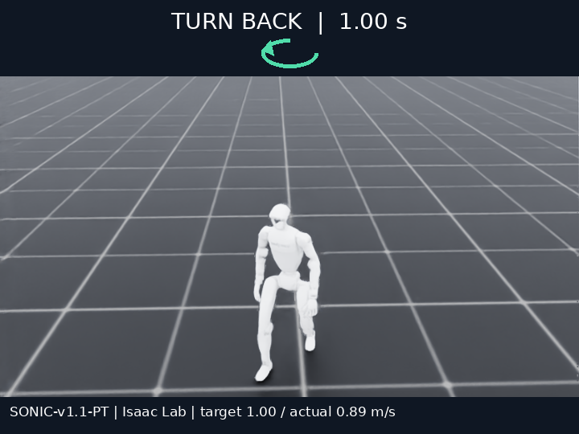

# RapidTurnBench

Unitree G1(29 DoF)이 **직진 중 갑자기 들어온 방향 신호(좌 / 우 / 뒤)에 얼마나 빠르고 안정적으로 몸과 진행 방향을 바꾸는지** 측정하는 Isaac Lab 벤치마크입니다.
제출한 모델을 같은 Isaac Lab task에서 실행해 정량 지표 표와 정성 평가용 영상을 생성합니다. 첫 baseline은 frozen NVIDIA SONIC v1.1입니다.



## Task

| 항목 | 설정 |
|---|---|
| Simulator | Isaac Lab / PhysX, 평지, 마찰 1.0 |
| Robot | Unitree G1 몸 관절 29 DoF, torque(effort) 제어 |
| 주기 | physics 200 Hz, policy 50 Hz |
| 시간 | 0–1 s 서기 → 1–3 s 1.0 m/s 직진 → **3 s에 방향 신호** → 6 s까지 관찰 |
| 조건 | 직진 유지 0°, 좌 +90°, 우 −90°, 뒤 180° (신호 직전 몸 방향 기준) |
| 반복 | 조건당 seed 0, 1, 2 (총 12 episode) |

신호 시점에 policy command(목표 XY 속도 + 목표 facing yaw)가 한 번에 바뀌며, 사전 예고는 없습니다.
설정 전체는 [configs/benchmark/isaac_quickcheck.yaml](configs/benchmark/isaac_quickcheck.yaml)에 있습니다.

## 1. 모델 올리는 방법

`submissions/<model_name>/` 폴더 하나가 제출 단위입니다.

```text
submissions/my_model/
  manifest.yaml
  policy.py
  weights/...        # 선택, manifest의 artifacts에 상대 경로로 나열
```

**manifest.yaml** — [submissions/sonic/manifest.yaml](submissions/sonic/manifest.yaml)을 복사해 이름만 바꾸면 됩니다.

```yaml
model_name: My-Model
model_version: '1'
contract_version: rapidturn-policy-v1
entrypoint: policy.py:Policy
action_type: joint_effort_nm
joint_names: [...]   # 아래 29개 관절 순서와 정확히 일치해야 함
artifacts: [weights/model.onnx]
```

관절 순서는 [configs/robot/isaac_g1.json](configs/robot/isaac_g1.json)의 `joint_names`(Unitree 순서: 왼다리 6, 오른다리 6, 허리 3, 왼팔 7, 오른팔 7)입니다.

**policy.py**

```python
class Policy:
    def load(self, artifact_dir, context): ...   # weights 로드
    def reset(self, seed): ...                   # episode 시작마다 호출
    def act(self, observation, command): ...     # 50 Hz, 29개 관절 torque(Nm) 반환
    def control(self, observation): ...          # 선택, 200 Hz마다 torque 재계산
    def close(self): ...
```

- `observation`: `timestamp`, `dt`, `root_position`, `root_quaternion`(wxyz), `root_linear_velocity`/`root_angular_velocity`(world),
  `body_angular_velocity`, `projected_gravity`, `torso_quaternion`, `torso_angular_velocity`,
  `joint_position`, `joint_velocity`, `previous_action` (모두 numpy, 관절은 위 순서).
- `command`: `target_velocity_xy`(world, m/s), `facing_yaw`(rad). 이후 신호나 seed별 정답은 주지 않습니다.
- 반환값은 29개 torque(Nm)입니다. Position-target 모델은 자기 PD를 policy 안에서 계산하세요.
  PD 모델은 `control()`을 정의해 physics 주기(200 Hz)로 torque를 다시 계산하는 것을 권장합니다. 50 Hz 동안 torque를 고정하면 불안정해집니다.
- torque는 관절별 effort limit으로 clip되고 clip 횟수가 기록됩니다. shape 오류나 NaN/Inf는 `invalid_action`으로 종료됩니다.
- `context`에는 `asset_profile`(관절 이름, nominal 자세, effort limit), `device`, `episode_dir`이 들어 있습니다.

예시: [submissions/standing_pd](submissions/standing_pd/policy.py)(최소 구조, 자세 PD만 있어 걷지는 못함) · [submissions/sonic](submissions/sonic/policy.py)(SONIC C++ 배포를 DDS로 연결).

## 2. 평가 방법

### 실행

Isaac Sim 5.1 + Isaac Lab이 설치된 Python이 필요합니다.

```bash
export ISAAC_PYTHON=/path/to/isaaclab/python
# 빠른 연결 확인: 좌 +90° 1회
bash scripts/evaluate_isaac.sh --submission submissions/my_model --angles 90 --seeds 0 --output results/isaac/my_model_bringup
# 전체 평가: 4조건 × 3 seed, 대표 영상 포함
bash scripts/evaluate_isaac.sh --video --submission submissions/my_model --output results/isaac/my_model
```

옵션: `--speeds 0.5 1.0 1.5`(속도별 비교), `--angles`, `--seeds`. RTX 5090에서 episode당 약 20초가 걸리며, 영상을 포함한 전체 평가는 약 4분입니다.

### 절차

각 episode는 G1을 같은 초기 자세로 reset → 4초 동안 root를 고정한 채 policy 준비 → 지지를 풀고 1초 안정화 → 측정(6초) 순서로 진행합니다.
측정 시작 시 root 높이가 0.5 m 미만이거나 기울기가 30°를 넘으면 `initialization_failed`로 기록하고 성능값을 만들지 않습니다.
시뮬레이션 시간 기준 lockstep으로 실행하므로 모델 추론 시간은 물리 시간에 영향을 주지 않습니다(추론 wall time은 별도 기록).

### 지표

| 지표 | 정의 |
|---|---|
| 신호 전 실제 속도 | 신호 전 마지막 0.5 s의 평균 XY 속도. 0.2 m/s 미만이면 `approach_failed` |
| 전환 도달 / 시간 | 0.2 s 평균 진행 방향과 torso heading이 **모두** 목표와 15° 이내이고, 속도가 max(0.2, 신호 전 속도×0.5) 이상인 상태가 0.2 s 유지된 첫 시각 − 신호 시각. 도달하지 못하면 값은 비워 둡니다(0으로 채우지 않음) |
| 속도 오차 | 신호 후 1.5 s 동안 실제 XY 속도와 목표 속도 벡터 차이의 평균(m/s) |
| 최대 기울기 | 신호 후 torso `sqrt(roll² + pitch²)`의 최댓값(°) |
| 전도 | root 높이 < 초기 높이×0.6 또는 기울기 > 60° |

### 출력 (`results/isaac/<run>/`)

`report.html`(표, XY 궤적, 영상) · `summary.csv` / `summary.md`(조건별 집계) · `episodes.csv`(전체 episode와 실행 상태) ·
`episodes/<id>/episode.npz`(지표를 다시 계산할 수 있는 실제 상태 로그) · `videos/<조건>_seed0.mp4`, `videos/demo.mp4` · `config.yaml` · `provenance.json`(모델·asset·코드 hash).
영상은 로봇 뒤를 따라가는 카메라로 촬영하며, 화면 상단에 방향 신호와 경과 시간, 하단에 요청/실제 속도가 표시됩니다.

## 3. 벤치마크 테이블

요청 속도 1.0 m/s, 조건당 3 seed. 전환 시간은 도달한 episode만 평균하고, 기울기는 episode별 최댓값의 평균입니다.
종합 점수 하나로 순위를 매기지 않고, 도달·속도 유지·기울기·전도를 함께 봅니다.

| Model | Task | N | 신호 전 실제 속도 (m/s) | 전환 도달 | 전환 시간 (s) ↓ | 속도 오차 (m/s) ↓ | 최대 기울기 (°) ↓ | 전도 ↓ |
|---|---|---:|---:|---:|---:|---:|---:|---:|
| SONIC-v1.1-PT | 직진 유지 0° | 3 | 0.896 | 3/3 | 0.15 | 0.296 | 11.7 | 0 |
| SONIC-v1.1-PT | 좌 +90° | 3 | 0.896 | 3/3 | 1.31 | 0.500 | 10.6 | 0 |
| SONIC-v1.1-PT | 우 −90° | 3 | 0.898 | 3/3 | 0.91 | 0.668 | 13.1 | 0 |
| SONIC-v1.1-PT | 뒤 180° | 3 | 0.895 | 3/3 | 1.35 | 0.832 | 15.7 | 0 |

[SONIC report](results/isaac/sonic_quickcheck/report.html) · [demo video](results/isaac/sonic_quickcheck/videos/demo.mp4) · [episodes.csv](results/isaac/sonic_quickcheck/episodes.csv)

직진 유지(0°)의 전환 시간은 회전 시간이 아니라, 0° 목표 방향 조건을 다시 만족하기까지 걸린 필터 지연입니다.
새 모델을 추가하려면 같은 profile로 평가한 뒤 `summary.md`의 행을 이 표에 붙이면 됩니다.

## SONIC baseline 재현 (선택)

SONIC baseline을 다시 돌릴 때만 필요합니다. 본인 모델 평가에는 필요하지 않습니다.

```bash
git clone https://github.com/NVlabs/GR00T-WholeBodyControl third_party/GR00T-WholeBodyControl
git -C third_party/GR00T-WholeBodyControl checkout b042411fae38ee4d1af9aac82a37a1f8d14d6dd0
bash scripts/setup_environment.sh   # 로컬 conda 런타임, Git LFS 메시, TensorRT, SONIC v1.1 체크포인트
bash scripts/build_sonic.sh         # 시뮬레이션 시간 lockstep 패치 후 C++ 배포 빌드
bash scripts/evaluate_isaac.sh --video --submission submissions/sonic --output results/isaac/sonic_quickcheck
```

`scripts/patch_sonic.py`는 공식 SONIC 배포에 파일 기반 command 입력과 시뮬레이션 시간 lockstep만 추가합니다. planner, policy, gain은 바꾸지 않습니다.

지표 단위 테스트: `python -m unittest discover -s tests -v`
